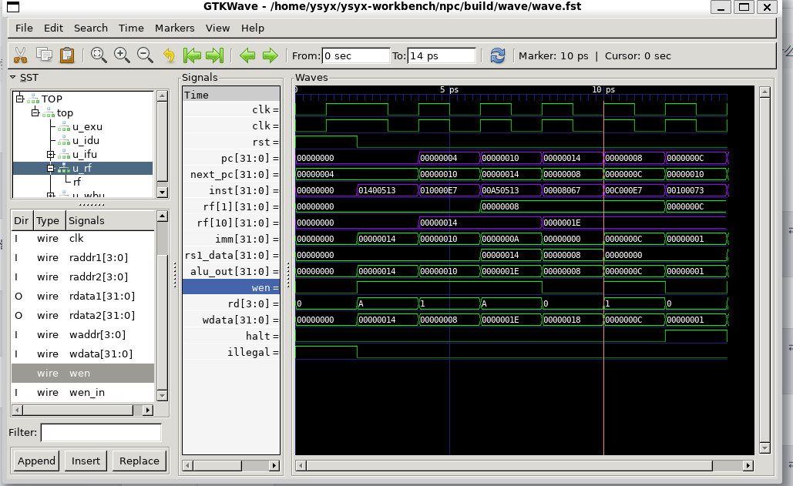

# E5 学习记录：功能完备的迷你 RISC-V 处理器

更新时间：2026-10-20
参考资料：[一生一芯 26.07 E5 讲义](https://ysyx.oscc.cc/docs/2607/e/5.html)、[RISC-V 指令集手册（非特权）](https://github.com/riscv/riscv-isa-manual/releases)、Verilator Manual

## 一、这一阶段做了什么

E5 是把 sCPU 升级成一个能跑 minirv 的处理器。我先读 RISC-V 手册，把 RV32I 的基本信息和 minirv 的 8 条指令整理出来，再用 C 写指令集模拟器 minirvEMU，最后用 Verilog 做模块化的 minirv NPC。

minirvEMU 的 B1～B5 都跑出了确定结果。RTL 这边先完成 `addi`、`jalr`，测试和波形都核对过，然后开始学 DPI-C：先把手册的例子跑通，再给 NPC 接上 `ebreak`。现在的进度是 `ebreak` 已经能结束仿真，`pmem_read`、`pmem_write` 正在写，还没接入 RTL。

代码在 WSL 的两个目录：

- `~/ysyx-workbench/minirvEMU/`：C 写的指令集模拟器。
- `~/ysyx-workbench/npc/`：RTL 处理器和 C++ 测试。

仓库里各存一份在 `e/e5/minirvEMU/` 和 `e/e5/npc/`。WSL 是工作副本，E 盘是快照，改完要手动复制。这一阶段有几次看的是没同步的旧代码，后来查代码前先确认两边的修改时间。

## 二、读手册，理解 minirv

讲义要求先 RTFM。我用的手册是 20261013 中间版，RV32I 在第 2 章 2.1 节，存储器定义在第 1.4 节，指令编码列表在 Appendix A。要回答的问题和查到的答案：

| 问题 | 手册答案 |
|---|---|
| RV32I 在哪一章 | 第 2 章 2.1 节 |
| PC 位宽 | 32 位（XLEN = 32） |
| GPR 数量、位宽 | 32 个（x0–x31），每个 32 位 |
| RISC-V 的 x0 和 sISA 的 R0 | x0 硬连线恒 0、只读；sISA 的 R0 是普通可读写的寄存器 |
| 指令编码位宽 | 32 位 |
| 基本格式 | R、I、S、U 四种，加 B、J 变体共 6 种 |
| 表示一个 GPR 要几位 | 5 位，2^5 = 32 |
| `add` 的格式 | R 型 |
| RV32E 和 RV32I 的差别 | RV32E 只有 16 个寄存器（x0–x15），编码相同，x16–x31 保留 |

minirv 的规范：PC 初值 0；GPR 数量同 RV32E；8 条指令 `add`、`addi`、`lui`、`lw`、`lbu`、`sw`、`sb`、`jalr`；其余同 RV32I。

从 Appendix A 抽出的编码：

| 指令 | 格式 | funct7 / 立即数 | rs2 | rs1 | funct3 | rd | opcode |
|---|---|---|---|---|---|---|---|
| `add` | R | `0000000` | rs2 | rs1 | `000` | rd | `0110011` |
| `addi` | I | imm[11:0] | — | rs1 | `000` | rd | `0010011` |
| `lui` | U | imm[31:12] | — | — | — | rd | `0110111` |
| `lw` | I | imm[11:0] | — | rs1 | `010` | rd | `0000011` |
| `lbu` | I | imm[11:0] | — | rs1 | `100` | rd | `0000011` |
| `sw` | S | imm[11:5] | rs2 | rs1 | `010` | imm[4:0] | `0100011` |
| `sb` | S | imm[11:5] | rs2 | rs1 | `000` | imm[4:0] | `0100011` |
| `jalr` | I | imm[11:0] | — | rs1 | `000` | rd | `1100111` |
| `ebreak` | SYSTEM | func12 = `000000000001` | `00000` | `000` | `00000` | `1110011` |

## 三、minirvEMU 的结构

### 1. 机器状态

| 状态 | 类型 | 说明 |
|---|---|---|
| `pc` | `uint32_t` | 从 sISA 的 8 位改成 32 位 |
| `R[16]` | `uint32_t` | 16 个 32 位寄存器（x0–x15） |
| `M[64]` | `uint32_t` | 定长存储器，代码区 0x00 起，数据区 0x40 起 |

`M` 必须定长。一开始写成 `uint32_t M[] = { 几条指令 }`，数组长度就定成“写了几条”，装不下数据区。改成 `M[64]` 后，字节地址 0～255 都在，`M[16]`（0x40）起留给数据。

`M` 每格 4 字节，字节地址除以 4 就是格子编号，`pc = 0x40` 对应 `M[16]`。

### 2. 主循环

一次执行做四件事：取指、切字段、执行、更新 PC。

取指用 `inst = M[pc / 4]`。字段的取法：

| 字段 | 位区间 | 取法 |
|---|---|---|
| opcode | [6:0] | `inst & 0x7f` |
| rd | [11:7] | `(inst >> 7) & 0x1f` |
| funct3 | [14:12] | `(inst >> 12) & 0x07` |
| rs1 | [19:15] | `(inst >> 15) & 0x1f` |
| rs2 | [24:20] | `(inst >> 20) & 0x1f` |
| funct7 | [31:25] | `(inst >> 25) & 0x7f` |

立即数先取 12 位原始码，再符号扩展：

```cpp
uint32_t imm12_i = (inst >> 20) & 0xfff;                          // I 型
uint32_t imm12_s = ((inst >> 25) << 5) | ((inst >> 7) & 0x1f);    // S 型
```

名字里的 12 和 32 是提醒位宽：`imm12_i`、`imm12_s` 是没扩展的原始值，扩展后叫 `imm32_i`、`imm32_s`，别把原始值直接拿来算。S 型的立即数拆成两段，[31:25] 是高 7 位，[11:7] 是低 5 位。

x0 靠“写的时候判 `rd != 0`”保证恒 0。PC 默认 `next_pc = old_pc + 4`，跳转指令再覆盖它。

## 四、B1：addi + jalr

先只做两条指令，跑讲义给的 6 行程序：

```text
0x00  0x01400513  addi x10,x0,20
0x04  0x010000e7  jalr x1,16(x0)
0x08  0x00c000e7  jalr x1,12(x0)
0x0c  0x00c00067  jalr x0,12(x0)    ← halt
0x10  0x00a50513  addi x10,x10,10
0x14  0x00008067  jalr x0,0(x1)
```

期望 a0 一路到 30，ra 依次是 8、12，最后 PC 停在 0xc。

这一段里程序结束靠“自跳”：最后一条 `jalr x0,12(x0)` 跳到它自己，PC 不再变化。我在循环里加了 `if (pc == old_pc) break;` 收尾。自跳的麻烦是偏移必须等于这条指令自己的地址，写错一位就飞出程序。

另外写了几条负立即数的 `addi` 测符号扩展：

| 编码 | 指令 | 结果 |
|---|---|---|
| `0x01400513` | `addi x10,x0,20` | 20 |
| `0xfff50513` | `addi x10,x10,-1` | 19 |
| `0xff650513` | `addi x10,x10,-10` | 9 |
| `0xfff00093` | `addi x1,x0,-1` | 0xFFFFFFFF |
| `0x00108093` | `addi x1,x1,1` | 0 |
| `0x80000513` | `addi x10,x0,-2048` | 0xFFFFF800 |

挑了 `-2048`（12 位补码的负边界）和 `-1 + 1`，都是容易抓出符号扩展错误的位置。

## 五、B2：add 和 lui

`add` 是 R 型，用到 rs2 和 funct7，`R[rd] = R[rs1] + R[rs2]`。`lui` 是 U 型，立即数 [31:12] 已经在它最终该在的位置，所以直接

```cpp
if (rd != 0) R[rd] = inst & 0xfffff000u;
```

测试用 `lui + addi` 拼一个 32 位常数：

| 编码 | 指令 | 结果 |
|---|---|---|
| `0x00500093` | `addi x1,x0,5` | x1 = 5 |
| `0x00700113` | `addi x2,x0,7` | x2 = 7 |
| `0x002081b3` | `add x3,x1,x2` | x3 = 12 |
| `0x00208033` | `add x0,x1,x2` | x0 仍为 0，写入被丢弃 |
| `0x123450b7` | `lui x1,0x12345` | x1 = 0x12345000 |
| `0x67808093` | `addi x1,x1,0x678` | x1 = 0x12345678 |

### 全局字段检查的坑

我最开始把 `funct3 != 0` 和 `rd >= 16` 放在入口做全局检查。做 `lui` 时才发现不行：U 型没有 funct3，它的 [14:12] 是立即数位，`lui x1,0x12345` 的 funct3 算出来是 5，被全局检查当成非法挡掉了。字段的含义随格式变，检查得放进对应格式的分支里。

## 六、B3：lw 和 sw

`lw`/`sw` 的地址是 `R[rs1] + 立即数`，一个是 I 型、一个是 S 型。`M` 是 `uint32_t[]`，整字访问用 `M[addr / 4]`：

```cpp
lw:  if (rd != 0) R[rd] = M[addr / 4];
sw:  M[addr / 4] = R[rs2];
```

`sw` 没有 rd，不要在这里判 `rd != 0`。

存一个值再读回的测试：

```text
0x00  0x04000093  addi x1,x0,64      x1 = 0x40
0x04  0x02a00113  addi x2,x0,42      x2 = 42
0x08  0x0020a423  sw   x2,8(x1)      存到 0x48
0x0c  0x0080a183  lw   x3,8(x1)      从 0x48 读回
0x10  0x02800067  jalr x0,40(x0)     halt
```

结果 `x3 = 42`。

这一段踩的坑：

- `case 010` 是八进制。funct3 的 `010` 是二进制 2，C 里 `010` 是八进制 8，两者永远不等，`lw`/`sw` 分支一次没进过。要写 `0x2`。
- `M + addr` 按元素偏移。`M` 是 `uint32_t*`，`M + addr` 往前走 `addr` 个元素，等于乘 4。字节地址 72 应该访问 `M[18]`，写成 `M + 72` 就到第 72 格去了。正解是 `M[addr / 4]`。
- `case` 少 `break` 会穿透。`sw` 执行完一路穿到 `default`，报 unsupported。编译器给的 `-Wimplicit-fallthrough` 警告就是提示。
- 数据不能放指令流里。我把测试数据 `0x12345678` 放在紧挨 `lw` 的 0x28 处，PC 顺着走过去把它当指令译码，报 `unsupported inst: 0x12345678`。数据要放在 PC 到不了的数据区（0x40 起）。

## 七、B4：lbu 和 sb

`lw`/`sw` 动整字，`lbu`/`sb` 只动 1 个字节，地址可能是任意字节。`M[addr/4]` 只会落到整字，这里要换成按字节看：

```cpp
((uint8_t*)M)[addr]        // 字节地址 addr 处的那个字节
```

`M[addr/4]` 是每格 4 字节的数，`((uint8_t*)M)[addr]` 是每格 1 字节的数，同一块内存，两种刻度。`lbu` 读出 `uint8_t` 赋给 32 位寄存器时自动零扩展，正好是它的语义；`sb` 只取最低字节写入。

逐字节读的测试：把 `0x12345678` 写到 0x40，小端下低字节在低地址。

| 地址 | 0x40 | 0x41 | 0x42 | 0x43 |
|---|---|---|---|---|
| 内容 | 0x78 | 0x56 | 0x34 | 0x12 |

`lbu` 依次读出 0x78、0x56、0x34、0x12，全对。

逐字节写的测试：

```text
0x04000093  addi x1,x0,64       x1 = 0x40
0x0ef00293  addi x5,x0,0xef     x5 = 0xef
0x0cd00313  addi x6,x0,0xcd     x6 = 0xcd
0x0ab00393  addi x7,x0,0xab     x7 = 0xab
0x09000413  addi x8,x0,0x90     x8 = 0x90
0x00508023  sb   x5,0(x1)       [0x40] = 0xef
0x006080a3  sb   x6,1(x1)       [0x41] = 0xcd
0x00708123  sb   x7,2(x1)       [0x42] = 0xab
0x008081a3  sb   x8,3(x1)       [0x43] = 0x90
0x0000a503  lw   x10,0(x1)      x10 = 0x90abcdef
0x02800067  jalr x0,40(x0)      halt
```

四个字节拼回 `0x90abcdef`。

## 八、B5：用 ebreak 结束程序

`ebreak` 是 SYSTEM 型：opcode `0x73`，funct3 0，rs1 和 rd 都是 0，靠 12 位 func12 区分，ebreak 为 1、ecall 为 0。整条编码是 `0x00100073`。

在 `switch` 里加 `case 0x73`：func12 等于 1 时打印提示并结束，不等于 1 的 SYSTEM 指令报错。测试程序末尾的自跳 halt 换成 `0x00100073` 后，程序跑到它自动停下：

```text
step=9 pc=0x00000020 inst=0x00100073 ... x6=00000078 x7=00000056 x8=00000034 x9=00000012 a0=00000000
HIT IN A TRAP @ PC=0x00000020
```

前面的 lbu 结果没有被改坏。程序结束从此由程序自己声明，不用再算 halt 的地址和偏移。循环末尾那段 `pc == old_pc` 的自跳检测也就成了死代码。

## 九、阶段 C～D：用 RTL 实现 minirv NPC

### 1. 模块划分

minirvEMU 是变量和条件，RTL 是寄存器和组合逻辑。当前按单周期组织：一个周期内算完取指、译码、执行，上升沿更新 PC 和 GPR。分成几个模块不等于流水线。

文件在 `~/ysyx-workbench/npc/`：

| 文件 | 职责 |
|---|---|
| `ifu.v` | 内部实例化 PC 寄存器，输出 `pc`，把 `inst_in` 传给 IDU |
| `idu.v` | 提字段、生成立即数，识别指令，输出控制信号、`illegal` 和 `halt` |
| `gpr.v` | 16 × 32 位寄存器堆，两个组合读口，一个上升沿写口；读 x0 为 0，写 x0 丢弃 |
| `exu.v` | 选择第二操作数，算加法 |
| `wbu.v` | 选择写回值和下一 PC |
| `top.v` | 连线；接收 `inst_in`，输出 `pc`、`illegal` |
| `template.v` | `Reg`、`MuxKey` 等模板 |

LSU 还没写。WBU 预留了 load 数据和 U 型立即数入口，但顶层 `load_data` 接的是 0，不能说访存和 `lui` 已经支持。

### 2. IDU 的写法和控制信号

I 型立即数直接复制符号位，不用照搬 C 里减 4096 的写法：

```verilog
wire [31:0] imm_i = {{20{inst[31]}}, inst[31:20]};
```

指令里的寄存器编号是 5 位，minirv 只有 16 个 GPR。IDU 检查完整编码的高位，向外只给 4 位地址：

```verilog
assign rd  = inst[10:7];
assign rs1 = inst[18:15];
assign rs2 = inst[23:20];
assign illegal = !supported || (uses_regs && (inst[11] || inst[19]));
```

`addi`/`jalr` 没有 rs2，它们编码的 [24:20] 是立即数，不能按 rs2 编号检查。加新格式时，合法性判断要按实际用到的字段重新组织。

控制信号按实际连接：

| 信号 | 当前含义 |
|---|---|
| `wen` | `!illegal` 且确实有写回目标；x0 的屏蔽在寄存器堆里做 |
| `alu_src` | 两条指令都是 1，第二操作数选立即数 |
| `wb_sel` | `00` 选 ALU，`01` 选 load 数据，`10` 选 U 型立即数，`11` 选 `pc+4`；后两个入口只是预留 |
| `pc_sel` | 0 选 `pc+4`，1 选跳转目标 |

`jalr` 把 `(rs1_data + imm_i) & 32'hfffffffe` 送给 PC，同时把 `pc+4` 写回 rd。

### 3. C++ 怎么驱动

存储器先放在 C++ 里，用 `uint32_t M[256]`，按 `M[pc/4]` 取指，访问前检查对齐和范围。`single_cycle()` 的顺序：拉低时钟求值，按当前 PC 给出 `inst_in`，再求值让组合结果稳定，检查 `illegal`，然后产生上升沿求值，完成写回和 PC 更新。

执行条数由测试目的决定，不由数组容量决定。现在固定跑 10 条，前 6 条走完程序，后 4 条验证末尾行为。

### 4. 运行结果

讲义那 6 条指令的 PC 轨迹：

```text
0x00 → 0x04 → 0x10 → 0x14 → 0x08 → 0x0c → 0x0c → …
```

末态：

```text
PC = 0x0000000c
a0 = 30
ra = 12
PASS: 3 checks
```

顺序执行、跳转、返回、写回都对。负立即数、非法寄存器编号、`jalr rd=rs1` 这些边界还没测。

### 5. 波形

用 `Makefile.wave` 构建，`make -f Makefile.wave view` 打开 GTKWave。逐拍看过：PC 轨迹和上面一致；`rf[10]`（a0）由 0 变 0x14 再变 0x1e；`rf[1]`（ra）由 0 变 8 再变 0xc；`rf[0]` 一直是 0；`illegal` 没有脉冲。写回都在上升沿之后，和“组合算、边沿存”对得上。

看波形时先展开 TOP，按实例挑信号。`MuxKey` 内部的 `key`/`lut`/`pair_list` 很多，直接用 `File → Write Save File` 存布局，省得每次重拖。

驱动在下一拍取指时才换 `inst_in`，上升沿刚过的一瞬间会出现“新 PC + 旧指令”的组合，看波形要和 C++ 的求值顺序对照。

### 6. 这一段遇到的问题

| 问题 | 怎么改的 |
|---|---|
| `jalr` 被判成非法 | 支持集合写成 `!(is_addi \|\| is_jalr)`，不是把 `is_jalr` 或进非法条件 |
| top 的 `rd/rs1/rs2[4]` 报未使用 | IDU 内部查高位，对外只给 4 位地址 |
| 控制编码前后不一致 | 按 IDU 和 WBU 的实际连接统一 `wb_sel`、`pc_sel` |
| 跑完程序后大量重复打印同一 PC | 末尾是自跳，测试还在给时钟；改成按执行次数控制 |
| 原 `make sim` 报顶层没有 `led` | 旧 NVBoard 约束对不上，改用不含 NVBoard 的构建入口 |

## 十、测试库和构建入口

原来比较实际值和期望值用 `main()` 里的 lambda，后来抽成 `csrc/test_suite.h`，不依赖 Verilator：

```cpp
TestSuite tests;
tests.check("halt pc", pc, 0x0c);
tests.check("halt a0", a0, 30);
tests.check("halt ra", ra, 12);
return tests.report();
```

`check()` 失败时打印十六进制差异并继续，`report()` 汇总，没有执行任何检查也算失败。

构建入口分开：

| 文件 | 用途 | 输出目录 |
|---|---|---|
| `Makefile.cpptest` | C++ 测试和 lint，不依赖 NVBoard | `build/cpp` |
| `Makefile.wave` | 同一个驱动，开启 FST 波形 | `build/wave` |
| `Makefile.test` | 兼容旧命令，包含 `Makefile.cpptest` | `build/cpp` |
| `Makefile` | 原 NVBoard 构建，E5 暂时不用 | 原目录 |

2026-10-19 把 `Makefile.cpp` 改名成 `Makefile.cpptest`：GNU Make 会把这个名字当成 C++ 源文件，走隐式规则，和测试目标搅在一起。改完把波形入口、兼容入口和 README 里的引用一起改了。

两套模式各用独立输出目录，带不带波形的产物不混。跑过的检查：

| 检查 | 结果 |
|---|---|
| `make -f Makefile.cpptest lint` | 通过 |
| `make -f Makefile.cpptest sim` | `PASS: 3 checks`（接 ebreak 之前） |
| `make -f Makefile.test test` | `PASS: 3 checks`（同上） |
| `make -f Makefile.wave wave` | 生成 `build/wave/wave.fst` |
| `fst2vcd` 解析 FST | 成功，能看到 PC、控制和数据通路信号 |

NVBoard 在 E5 暂时不用，安装和 E4 的约束都留着。当前顶层没有 `led`，也不打算为旧的 LED 约束改 minirv 顶层，等 E7 接 SoC 再处理。

## 十一、阶段 E：DPI-C

### 1. 先跑手册的例子

讲义要求先把 Verilator 手册里 DPI 的例子跑通。手册的例子只有 Verilog 和 C++ 两小段，C++ 那边缺一个 main，我参考自己原来的测试补上。文件放在 `npc/tb/`：

`our.v`：

```verilog
module our;
    import "DPI-C" function int add(input int a, input int b);

    initial begin
        $display("1 + 2 = %0d", add(1, 2));
        $display("3 + 4 = %0d", add(3, 4));
    end
endmodule
```

`sim.cpp` 里 include `Vour__Dpi.h`，写 `int add(int a, int b)`，main 里构造 `Vour` 后 `eval()` 一次。

```bash
verilator --cc our.v --exe sim.cpp --build -j 0
./obj_dir/Vour
```

输出：

```text
[C++ add] a=1 b=2
1 + 2 = 3
[C++ add] a=3 b=4
3 + 4 = 7
```

生成的 `Vour__Dpi.h` 中间是：

```cpp
// DPI import at our.v:3:33
extern int add(int a, int b);
```

整段声明包在 `extern "C" { }` 里。

### 2. 对 DPI-C 的理解

DPI-C 不是一份现成的函数库，也没有哪个函数是 Verilator 自带的。`add` 是我自己写的，`pmem_read` 以后也是。DPI-C 只是一套调用规则：Verilog 里用 `import` 写声明，Verilator 把它转写成 `__Dpi.h` 里的 C 原型，链接时和 C++ 的实现对上。

`__Dpi.h` 就是普通的头文件，不是运行时反射。名字只在编译和链接期起作用，运行时就是一条函数调用。删掉实现，报的是链接错误 `undefined reference`，不是运行时报错。

调用点放在哪个块里，就按那个块的规则执行。`import` 的声明和调用点是两回事：声明只给签名，调用点决定什么时候进 C++。

### 3. 给 NPC 接 ebreak

`ebreak` 的编码是 `0x00100073`，ecall 是 `0x00000073`，两者只差 func12 的最低位。IDU 里我直接匹配整条指令：

```verilog
wire is_ebreak = (inst == 32'h00100073);
```

再把支持集合、`illegal`、`wen` 一起改：`ebreak` 算合法，但不写 GPR；`halt = is_ebreak`。

top 里在模块作用域写声明，然后加调用：

```verilog
import "DPI-C" function void ebreak(input int pc);

always @(posedge clk) begin
    if (!rst && halt) ebreak(pc);
end
```

讲义给的模板用 `always @(*)`。我放在 `posedge` 里，是想让这个有副作用的调用每拍最多发生一次；组合块在同一次 `eval()` 里可能被重算多次，ebreak 重复调用虽然无害，但以后 `pmem_write` 也要这么考虑。

C++ 侧：

```cpp
extern "C" void ebreak(int pc) {
    hit_ebreak = true;
    halt_pc = pc;
    printf("ebreak @ pc=0x%08x\n", halt_pc);
    Verilated::gotFinish(true);
}
```

测试主循环从固定 10 拍改成 `while (!ctx.gotFinish() && cycles < max_cycles)`，结束条件交给 ebreak。检查项加了 `hit ebreak` 和 `ebreak pc`，程序停在 0x0c，a0 和 ra 还是 30 和 12。

名字上要注意：IDU 的输出如果直接叫 `ebreak`，会和 top 里 import 的函数重名，所以叫 `halt`，顶层的声明和调用都用函数名。

### 4. 把访存接口拆出来（已完成）

讲义给的签名是 `import "DPI-C" function int pmem_read(input int raddr);` 和 `pmem_write(waddr, wdata, wmask)`。存储器用 `uint32_t M[256]` 按字保存，地址以字节计数；lw/sw 对齐访问，lbu/sb 由 RTL 选择字节通道。

`pmem_read` 先把地址低两位清零，越界时报错退出，返回对齐的字。`pmem_write` 按 `wmask` 逐字节改：`wmask` 的第 i 位对应地址 `a+i`，循环里用 `0xffu << (8*i)` 做字节掩码，只替换 mask 选中的字节。字节的选择留给 RTL，C++ 只按 mask 执行。

文件分工：`pmem.cpp` 保存存储器并实现读写，`dpi.cpp` 处理 ebreak 回调，`sim.cpp` 管理时钟、复位、单拍执行和波形，`main.cpp` 装载程序并运行。DPI 实现包含生成的 `Vtop__Dpi.h`，避免手写声明与 RTL 签名不一致。

现在 IFU 已通过组合块调用 `pmem_read(pc)`，复位时屏蔽读取；顶层不再有 `inst_in`。LSU 组合读、上升沿写，`lbu` 选择地址对应字节并零扩展，`sb` 同时移动数据和 mask。`dpi_reset()` 只清除回调状态，仿真结束标志由 `sim_init()` 中的 context 统一清除。

运行接口统一为 `sim <program.bin> [wave.fst]`。文件按小端装载，要求非空、长度为 4 的倍数、容量不超过 1024 字节，未装载区域清零。程序文件在 argv[1]，波形路径在 argv[2]，不再冲突。

### 5. GTKWave：区分上升沿前后的指令与写使能

2026-10-20 查看当前程序的波形，重点核对返回指令和寄存器堆实际写使能：



截图中的光标位于 10 ps。上升沿之前（约 8～10 ps）执行的是 `jalr x0, 0(ra)`：PC 为 `0x14`，ra 为 `8`，所以 `alu_out` 和 `next_pc` 都为 `8`，待写回值 `pc+4` 为 `0x18`，但 rd 为 0。

这时要区分两个写使能：IDU 发出的 `wen_in` 仍为 1，而寄存器堆内部的 `wen = wen_in && (waddr != 0)` 为 0，因此 x0 不会被写入。截图添加的是 `u_rf` 内部的 `wen`，能看到它在 rd 为 0 的区间拉低。

10 ps 上升沿完成返回，PC 更新为 `8`。沿后组合电路已经开始处理下一条 `jalr ra, 12(x0)`，此时 rd 为 1，内部 wen 又拉高。不能用沿后的控制信号去解释刚刚完成的上一条指令。

右侧执行到 `ebreak` 时，指令为 `0x00100073`，`halt=1`、`illegal=0`、`wen=0`。即使 ALU 或 wdata 上还有数值，只要写使能无效，就不会写入 GPR。

以后看波形按“复位与时钟 → 当前 PC 和指令 → 操作数与运算结果 → 写回控制 → 上升沿后的状态”逐条核对。

## 十二、补齐指令、汇编工具和分类测试

2026-10-20 收尾核对：IFU、IDU、EXU、LSU、WBU、GPR 已接通，支持 `addi/add/lui/jalr/lw/lbu/sw/sb` 和 `ebreak`。EXU 计算的地址送 LSU；WBU 从 ALU、load_data、U 型立即数、pc+4 中选写回值。状态在时钟上升沿更新，组合信号描述当前指令。

`tools/mkprog.py` 把 `.s` 转为小端 `.bin` 和逐条 `.hex`；支持上述指令、寄存器别名、标签，以及用 jalr 展开的 `j label`。这是当前 minirv 的小工具，j 的标签是绝对地址，不是 PC 相对跳转。汇编器自身 9 项单元测试通过。

测试期望写在汇编源码的 `# EXPECT` 注释里，独立运行器用 `TestSuite` 检查。非法编码通过测试驱动注入，汇编器仍拒绝非法寄存器。功能和边界分开执行，输出会标明组名、案例名及实际值/期望值。

| 测试组 | 程序数 | 检查内容 |
|---|---:|---|
| functional | 4 | 算术、跳转、字和字节访存 |
| boundary | 14 | 立即数符号扩展、U 型拼接、x0、非法寄存器、jalr rd=rs1、未支持编码、连续跳转 |
| difftest 规模组 | 2 | 小程序与含循环、数组的中程序 |
| acceptance | 3 | 求和、数组读写、字节修改 |

前两组独立 NPC 回归共 199 项检查；包含全部四组的 DiffTest 共 23 个案例。

## 十三、DiffTest：每条指令对照参考模型

minirvEMU 从单文件拆为 `emu.h`（状态和接口）、`emu.cpp`（不打印的执行核心）、`main.cpp`（独立运行入口）。NPC 的 `csrc/difftest.cpp` 直接复用同一份 emu.cpp，避免另外维护一份参考逻辑。

驱动装载同一个文件，在每步执行前保存 PC 和指令；NPC 走一拍、EMU 走一条，再比较 PC 和 x0～x15。程序结束后比较完整 1024 字节内存，并核对汇编注释里的独立期望。

**ebreak 约定：**NPC 在上升沿回调，PC 正常前进；EMU 停在 ebreak 地址。普通步比较执行后的 PC，halt 那步改为比较执行前 PC；两边仍检查寄存器和 halt 状态。不是忽略所有 PC 检查。

测试驱动在开始时显式统一寄存器初态；这不表示 RTL 的 reset 会清零整个寄存器堆。DiffTest 关闭逐拍打印，失败时保留 step、执行前 PC、指令，并一次打印本步所有差异。

| 验证 | 结果 |
|---|---|
| 小程序 | 动态 13 条，PC/GPR 共 221 项通过 |
| 中程序 | 动态 80 条，PC/GPR 共 1360 项通过 |
| 故意把 EXU 加法改错 | 第 1 步捕获；恢复后重新构建通过 |
| 故意改错 sb 的 mask 移位 | 第 9 步读回捕获；恢复后重新构建通过 |
| 故意关闭 addi 写使能 | 第 1 步捕获；恢复后重新构建通过 |
| 同时改错运算与 PC | 同一步列出两处差异，验证不会只报第一处 |

故意改错只用于证明检查器能发现错误，当前 RTL 已恢复。详细案例和输出规则见 [测试说明](npc/tests/README.md)。

## 十四、大程序验收

三个程序都用 mkprog 汇编，分别运行 NPC、独立 EMU，再执行逐条 DiffTest；三种入口共 9 次运行通过。最终寄存器、整块内存由 DiffTest 对比，手算期望由 TestSuite 额外检查。

| 源程序 | 独立期望 | 动态指令数 |
|---|---|---:|
| `sum_1_to_10.s` | a0=55 | 23 |
| `array_sum.s` | 0x80 起存 1/2/3/4，读回求和 a0=10 | 20 |
| `byte_sum.s` | 存 0x12345678，逐字节求和 a0=0x114；修改后内存=0x12ab5678 | 17 |

程序在 `npc/tests/programs/acceptance/`，期望直接写在源码注释中。求和采用展开的加法序列；另有中程序验证循环。三个验收程序合计覆盖全部 8 条指令和 ebreak。

## 十五、收尾验证与波形抽查

NPC RTL lint、EMU C++ lint、汇编器单元测试、全部 23 个 DiffTest 案例通过。波形由真实仿真生成 FST，转换为 VCD 后脚本读取沿前、沿后数值核对，本次没有把自动解析说成人工 GTKWave 查看。

| 指令 | 程序与执行前 PC | 上升沿 | 观察结果 |
|---|---|---|---|
| add | array_sum，0x34 | 28 ps | rs1=0、rs2=1，ALU=1，沿后 a0=1 |
| lw | array_sum，0x30 | 26 ps | 地址0x80，load_data=1，WBU 选择 load，沿后 t1=1 |
| sb | byte_sum，0x38 | 32 ps | 地址0x102，数据0x00ab0000，mask=0x04，GPR wen=0 |

这里的 ps 是测试驱动的仿真时间单位，不是实际硬件运行频率。原先 jalr 的 GTKWave 截图保留在第十一节。

```bash
cd ~/ysyx-workbench/npc
make -f Makefile.cpptest lint
make -f Makefile.cpptest test-functional
make -f Makefile.cpptest test-boundary
make -f Makefile.cpptest test-acceptance
make -f Makefile.diff
make -f Makefile.cpptest check-waves
# 打开某份验收程序的 GTKWave：
make -f Makefile.wave wave PROGRAM=build/acceptance/programs/byte_sum.bin
```

`npc/README.md` 已补上接口、参数、DiffTest 命令和复盘入口。忽略规则保留 `.s`、测试脚本和 EMU 源码，屏蔽 build/、obj_dir/、bin/FST/VCD 等产物。工作台父级原本会忽略 EMU 的 cpp/h，已用 minirvEMU 的局部规则放行。

WSL 的 npc 和 minirvEMU 复制到 E 盘独立目录，复制后核对内容和修改时间；保留 WSL 原目录。Git add/commit 由我自己在 WSL 执行，本轮不自动提交。

## 十六、接下来：复盘代码、架构、驱动、测试

当前先结束新增功能，按能跟踪一条指令的顺序理解已有实现：

1. **代码：**从 main.cpp 看程序文件如何装入内存，仿真怎样开始和结束。
2. **架构：**拿一条 addi 跟踪 PC→取指→译码→读寄存器→运算→写回，再看 lw/sb/jalr 的差别。
3. **驱动：**逐句解释 sim_init/reset/step、eval、时钟上升沿、DPI 回调、波形记录的先后关系。
4. **测试：**区分手写期望、TestSuite、独立 EMU、DiffTest；亲自追踪一次失败报告。

每次只讲清一段调用或一条指令，确认能自己解释之后再往下。
